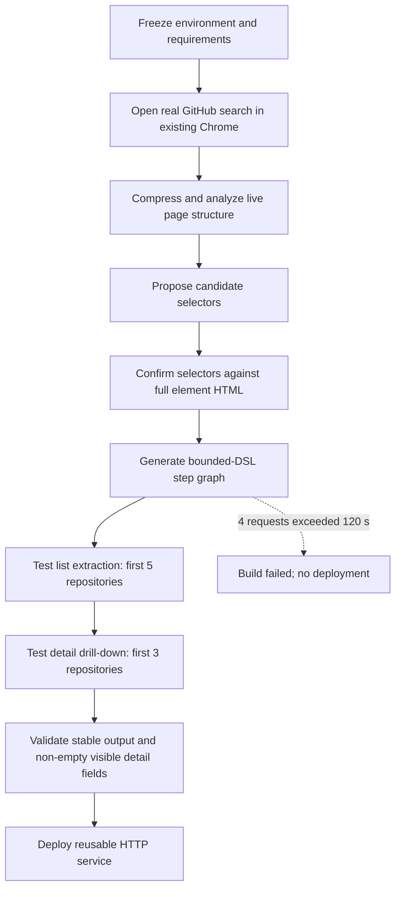

# E1 Service A — Build 1 Report

## Status

**Outcome:** Failed build, retained as first-class experimental evidence.

The official attempt began on 2026-08-26 at 15:38:37.353 UTC+08:00 and failed at 15:51:43.980 UTC+08:00. The measured wall time was 786.6 seconds. Scrapewright completed the initial page-analysis and selector-research calls, but could not obtain a response for step generation within the configured timeout. No service was deployed from this attempt.

Configuration and calibration activity before the official start is excluded from this report and from E1 measurements.

## Experimental objective

Build the E1-A representative service for the task class **search -> result list -> per-item detail-page drill-down**. The target was an existing public website opened in the user's already-running Chrome browser through the Scrapewright extension. No headless browser, synthetic local target, or account-changing action was used.

## Frozen configuration

| Parameter | Value |
|---|---|
| Service identifier | `e1-a-github-repository-search` |
| Target | GitHub public repository search |
| Initial URL | `https://github.com/search?q=web+scraping&type=repositories` |
| Scrapewright provider setting | OpenAI |
| Actual API service | Alibaba Cloud Model Studio |
| Protocol | OpenAI-compatible chat completions |
| Model | `deepseek-v4-pro` |
| Endpoint type | China (Beijing) workspace-dedicated |
| Per-request timeout | 120 seconds |
| Scrapewright version | 0.1.0 |
| Repository commit | `afd5376c43cd97fb2108cc216a1cf1aa2324f032` |
| Chrome | 143.0.7499.170 |
| Node.js | v24.19.0 |
| Host port | 8765 |
| Extension connection | Connected at start |
| Chrome throttle-disable flags | Off |

The API key and workspace-specific endpoint identifier are intentionally omitted.

## Exact Phase 1 wizard input (verbatim)

### Target URL

```text
https://github.com/search?q=web+scraping&type=repositories
```

### Input parameters

```text
query — required string; GitHub repository search phrase. Test value: web scraping
```

### Page operations and data to collect

```text
Search GitHub public repositories using the query input. Extract exactly the first five repository results. For every result collect repository name, owner, description, repository URL, star count, primary language, and last-updated text. Open each of the first three repository detail pages and additionally collect non-empty About text, topics, and default branch. A detail-page record is not successful if these fields are empty when they are visibly available. Do not modify, star, follow, or otherwise interact with account data.
```

### Output structure

```text
{
  query: string,
  repositories: [{
    name: string,
    owner: string,
    description: string,
    url: string,
    stars: string,
    language: string,
    updatedText: string,
    about: string,
    topics: string[],
    defaultBranch: string
  }]
}
```

+## Input parameters

| Name | Type | Required | Test value | Meaning |
|---|---|---:|---|---|
| `query` | string | yes | `web scraping` | GitHub repository search phrase |

## Frozen task specification

Search GitHub public repositories using `query` and extract exactly the first five results. For each result, collect:

- repository name;
- owner;
- description;
- repository URL;
- star count;
- primary language; and
- last-updated text.

Open each of the first three repository detail pages and additionally collect non-empty About text, topics, and default branch. A detail-page record is not considered successful if these fields are empty when they are visibly available. The workflow must not modify, star, follow, or otherwise interact with account data.

The requested stable output contract was:

```text
{
  query: string,
  repositories: [{
    name: string,
    owner: string,
    description: string,
    url: string,
    stars: string,
    language: string,
    updatedText: string,
    about: string,
    topics: string[],
    defaultBranch: string
  }]
}
```

## Test-design schematic



The intended post-deployment E1 procedure—ten LLM-free HTTP executions followed by provider-usage reconciliation—was not reached because the build failed.

## Observed execution

The raw console trace shows:

1. Three LLM calls returned HTTP 200 with `finish_reason: stop`.
2. Live GitHub page structure was included in the research context.
3. Candidate result-container selectors were proposed.
4. Selector evidence was checked against full element HTML; the trace includes a confirmed repository-link selector.
5. The wizard entered `generateStepsWithSelectors` to produce the executable step graph.
6. That request timed out after 120 seconds.
7. Scrapewright retried automatically three times, using backoffs of 1.028, 2.240, and 4.080 seconds.
8. All four step-generation attempts timed out, producing `LLMRetryExhausted`.
9. The wizard stopped before test execution and deployment.

## Token accounting

### Responses with returned usage

| Successful response | Input tokens | Output tokens | Total tokens | Reasoning tokens | Cached input tokens |
|---:|---:|---:|---:|---:|---:|
| 1 | 23,536 | 329 | 23,865 | 267 | 0 |
| 2 | 8,100 | 1,882 | 9,982 | 1,493 | 0 |
| 3 | 12,583 | 5,648 | 18,231 | 5,189 | 0 |
| **Measured sum** | **44,219** | **7,859** | **52,078** | **6,949** | **0** |

The E1 CSV records 44,219 input and 7,859 output tokens as a **measured lower bound**. These are not asserted to be the final billable totals.

### Unresolved timeout exposure

Four step-generation requests returned no response usage because the browser client aborted each request at 120 seconds. They may nevertheless have consumed provider-side tokens before cancellation. Their billable input/output totals cannot be inferred honestly from the browser log and must be reconciled later against Alibaba Model Studio monitoring. Until that reconciliation, total build cost is right-censored above the measured 52,078 tokens.

## Failure analysis

### Immediate cause

`generateStepsWithSelectors` exhausted four attempts because every request exceeded the configured 120-second client timeout. The terminal exception was `LLMRetryExhausted`.

### What the evidence rules out

- The host and Chrome extension were connected at the official start.
- The endpoint URL and model identifier were functional: three preceding calls returned HTTP 200.
- The target page was reachable and analyzable in the real browser.
- This was not the earlier setup/calibration problem involving endpoint formatting or model-name capitalization; those checks occurred before the official measurement window and are excluded.

### Most defensible interpretation

The failure occurred at the largest and most reasoning-intensive generation stage, not at transport setup or initial page grounding. The trace establishes a client-side timeout boundary but does not establish whether the upstream service was still computing, stalled, or completed after the client aborted. Provider monitoring is required to distinguish those possibilities.

## Notable methodological observations

- **Failure retention:** The attempt remains in the dataset rather than being replaced by a successful run.
- **Retry amplification:** One slow logical stage produced four potentially billable API requests. This is important to the paper's token-economics claim: compile-time cost can be materially affected by retry policy.
- **Lower-bound reporting:** Browser-returned usage is separated from provider-side usage that may later appear for timed-out calls.
- **No runtime claim:** Because deployment was never reached, Build 1 provides no evidence for zero-token runtime execution.
- **No semantic-success claim:** Selector research progressed, but no step graph was produced or tested; the requested output contract was never validated.
- **Configuration integrity:** The official attempt used the frozen 120-second timeout. Any later timeout adjustment must be reported as a separate intervention.

## Evidence and provenance

- Environment record: `env.txt`
- Aggregate E1 data: `e1-tokens.csv`
- Raw browser console log: `e1-builds/build-1/console.log`
- Raw-log SHA-256: `F4EFC80A804B036B6E73F4728C8AF96487578BCD0D0A7B362E7CB586F212F297`

The raw log contains full research prompts and page excerpts. It should be treated as research data and reviewed for incidental page/account information before public release.

## Follow-up required

1. Query Alibaba Model Studio monitoring after its reporting delay and reconcile all four timed-out requests.
2. Preserve the same task specification for the next attempt.
3. Record any timeout or model change explicitly rather than folding it into Build 1.
4. If a later build succeeds, keep Build 1 in cost and reliability analyses and report the successful build separately.
