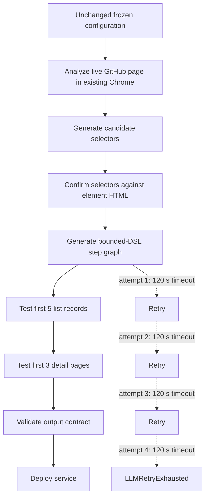

# E1 Service A — Build 2 Report

## Status

**Outcome:** Failed replication build, retained as first-class experimental evidence.

Build 2 began on 2026-08-26 at 16:06:43.934 UTC+08:00 and failed at 16:18:46.288 UTC+08:00. The measured wall time was 722.4 seconds. It reproduced Build 1's terminal behavior under the unchanged frozen configuration: live-page research and selector confirmation succeeded, but all four attempts to generate the executable step graph exceeded the 120-second client timeout. No service was deployed.

## Purpose

Build 2 was a direct replication of Build 1, requested before changing the timeout. Its purpose was to determine whether Build 1's step-generation failure was transient or reproducible.

No task, model, endpoint, timeout, browser, or output-contract change was introduced between the attempts.

## Frozen configuration

| Parameter | Value |
|---|---|
| Service identifier | `e1-a-github-repository-search` |
| Task class | Search -> result list -> per-item detail-page drill-down |
| Target | GitHub public repository search |
| Initial URL | `https://github.com/search?q=web+scraping&type=repositories` |
| Scrapewright provider setting | OpenAI |
| Actual API service | Alibaba Cloud Model Studio |
| Protocol | OpenAI-compatible chat completions |
| Model | `deepseek-v4-pro` |
| Endpoint type | China (Beijing) workspace-dedicated |
| Per-request timeout | 120 seconds |
| Browser | User's already-running Chrome through the Scrapewright extension |
| Account-changing actions | Prohibited |

The API key and workspace-specific endpoint identifier are intentionally omitted.

## Exact Phase 1 wizard input (verbatim)

### Target URL

```text
https://github.com/search?q=web+scraping&type=repositories
```

### Input parameters

```text
query — required string; GitHub repository search phrase. Test value: web scraping
```

### Page operations and data to collect

```text
Search GitHub public repositories using the query input. Extract exactly the first five repository results. For every result collect repository name, owner, description, repository URL, star count, primary language, and last-updated text. Open each of the first three repository detail pages and additionally collect non-empty About text, topics, and default branch. A detail-page record is not successful if these fields are empty when they are visibly available. Do not modify, star, follow, or otherwise interact with account data.
```

### Output structure

```text
{
  query: string,
  repositories: [{
    name: string,
    owner: string,
    description: string,
    url: string,
    stars: string,
    language: string,
    updatedText: string,
    about: string,
    topics: string[],
    defaultBranch: string
  }]
}
```

+## Input parameters

| Name | Type | Required | Test value | Meaning |
|---|---|---:|---|---|
| `query` | string | yes | `web scraping` | GitHub repository search phrase |

## Frozen test design

The service was required to extract exactly the first five public GitHub repository search results. For every result it had to return repository name, owner, description, URL, star count, primary language, and last-updated text. It then had to open the first three detail pages and return non-empty About text, topics, and default branch whenever those fields were visibly available.

The stable output contract remained:

```text
{
  query: string,
  repositories: [{
    name: string,
    owner: string,
    description: string,
    url: string,
    stars: string,
    language: string,
    updatedText: string,
    about: string,
    topics: string[],
    defaultBranch: string
  }]
}
```



## Observed execution

1. The first three LLM requests returned HTTP 200 with `finish_reason: stop`.
2. The live GitHub result page was analyzed in the user's browser.
3. Candidate selectors were produced.
4. Full element HTML was used to confirm or revise selectors.
5. Some requested selectors were visibly reported as `NOT FOUND` during evidence collection, including candidate selectors for programming language, relative time, repository description, topic tags, and branch UI. This is research evidence, not itself the terminal failure.
6. The wizard invoked `generateStepsWithSelectors`.
7. Four identical logical attempts exceeded the 120-second client timeout.
8. Automatic retry backoffs were 1.462, 2.338, and 4.421 seconds.
9. The wizard terminated with `LLMRetryExhausted` at 16:18:46.288 UTC+08:00.
10. Test execution, semantic validation, and deployment were never reached.

## Token accounting

### Responses with returned usage

| Successful response | Input tokens | Output tokens | Total tokens | Reasoning tokens | Cached input tokens |
|---:|---:|---:|---:|---:|---:|
| 1 | 23,537 | 1,196 | 24,733 | 1,126 | 17,408 |
| 2 | 8,101 | 2,715 | 10,816 | 2,231 | 3,072 |
| 3 | 1,367 | 4,237 | 5,604 | 3,724 | 0 |
| **Measured sum** | **33,005** | **8,148** | **41,153** | **7,081** | **20,480** |

The CSV records 33,005 input and 8,148 output tokens as a measured lower bound. Cached tokens are included in the provider's reported `prompt_tokens`; they are shown separately here because cache pricing may differ.

### Unresolved timeout exposure

The four timed-out step-generation requests returned no usage objects. They may have consumed provider-side input, reasoning, and output tokens before the browser aborted them. Consequently, 41,153 is not a complete billable total. Alibaba Model Studio monitoring must be used to reconcile those requests after its reporting delay.

## Failure analysis

### Immediate cause

Every `generateStepsWithSelectors` attempt exceeded the configured 120-second per-request timeout. After the fourth timeout, Scrapewright raised `LLMRetryExhausted` and stopped the build.

### Reproducibility conclusion

Build 2 reproduced Build 1's failure at the same function and retry boundary while holding the experimental configuration constant. This substantially weakens the hypothesis that Build 1 was a one-off network transient. The evidence instead points to a systematic incompatibility between the 120-second client budget and this stage's latency under the chosen model, prompt size, endpoint, and retry policy.

The experiment does not isolate which of prompt complexity, reasoning latency, provider load, or another upstream factor caused the long response time. It establishes only that the current end-to-end configuration repeatedly fails at the client timeout boundary.

## Controlled comparison with Build 1

| Metric | Build 1 | Build 2 | Interpretation |
|---|---:|---:|---|
| Successful responses before terminal stage | 3 | 3 | Same pipeline depth reached |
| Returned input tokens | 44,219 | 33,005 | Variable research-context cost |
| Returned output tokens | 7,859 | 8,148 | Similar magnitude |
| Returned total tokens | 52,078 | 41,153 | Both are lower bounds |
| Timed-out step-generation requests | 4 | 4 | Exact terminal pattern reproduced |
| Client timeout | 120 s | 120 s | Controlled |
| Terminal function | `generateStepsWithSelectors` | `generateStepsWithSelectors` | Controlled/reproduced |
| Deployment reached | no | no | No runtime evidence |

Across both builds, successful responses alone account for at least **77,224 input tokens**, **16,007 output tokens**, and **93,231 total tokens**, excluding eight timed-out requests. This combined value must not be mistaken for the cost of a successful deployed service.

## Methodological implications

- The repeated failure is reportable build reliability evidence, not disposable setup noise.
- Automatic retries can amplify compile-time token exposure even when no deployable artifact is produced.
- Client-side response usage is insufficient for aborted requests; provider-side monitoring is necessary.
- A later increase in timeout is now justified as a documented recovery intervention, not an unexplained configuration change.
- No claim about zero-token runtime execution can be drawn until a service is successfully deployed and run.

## Evidence and provenance

- Raw browser console log: `e1-builds/build-2/console.log`
- Raw-log SHA-256: `60720506DB674534D5AF2CA72C28AB733E31B97B7C14D5732472AFAB92841455`
- Aggregate E1 measurements: `e1-tokens.csv`
- Shared environment record: `env.txt`

The raw console log contains full prompts and excerpts from the live page. Review it for incidental page/account information before public release.

## Follow-up required

1. Reconcile all four timed-out calls with Alibaba Model Studio monitoring.
2. Preserve Build 2 unchanged as the controlled replication.
3. If attempting Build 3 with a longer timeout, record that timeout change explicitly as the only planned intervention.
4. Create Build 3's `report.md` only after its raw `console.log` has been saved and verified.
