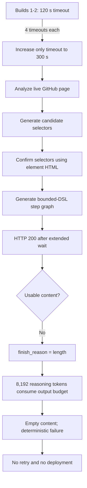

# E1 Service A — Build 3 Report

## Status

**Outcome:** Failed recovery build, retained as first-class experimental evidence.

Build 3 began on 2026-08-26 at 16:38:07.302 UTC+08:00 and failed at 16:45:07.035 UTC+08:00. The measured wall time was 419.7 seconds. Increasing the per-request timeout from 120 to 300 seconds removed the previously observed timeout boundary and allowed step generation to return HTTP 200. The response nevertheless contained no usable content because the model exhausted the configured 8,192-token completion budget on reasoning. No service was deployed.

## Intervention under test

Build 3 changed exactly one planned configuration variable relative to Builds 1 and 2:

```text
Per-request timeout: 120 seconds -> 300 seconds
```

The model, endpoint, target, task specification, input, output contract, browser, and prohibition on account-changing actions remained unchanged.

## Frozen configuration

| Parameter | Value |
|---|---|
| Service identifier | `e1-a-github-repository-search` |
| Task class | Search -> result list -> per-item detail-page drill-down |
| Target | GitHub public repository search |
| Initial URL | `https://github.com/search?q=web+scraping&type=repositories` |
| Input | `query = "web scraping"` |
| Scrapewright provider setting | OpenAI |
| Actual API service | Alibaba Cloud Model Studio |
| Protocol | OpenAI-compatible chat completions |
| Model | `deepseek-v4-pro` |
| Endpoint type | China (Beijing) workspace-dedicated |
| Per-request timeout | 300 seconds |
| Maximum output tokens | 8,192 |
| Browser | User's already-running Chrome through the Scrapewright extension |

The API key and workspace-specific endpoint identifier are intentionally omitted.

## Exact Phase 1 wizard input (verbatim)

### Target URL

```text
https://github.com/search?q=web+scraping&type=repositories
```

### Input parameters

```text
query — required string; GitHub repository search phrase. Test value: web scraping
```

### Page operations and data to collect

```text
Search GitHub public repositories using the query input. Extract exactly the first five repository results. For every result collect repository name, owner, description, repository URL, star count, primary language, and last-updated text. Open each of the first three repository detail pages and additionally collect non-empty About text, topics, and default branch. A detail-page record is not successful if these fields are empty when they are visibly available. Do not modify, star, follow, or otherwise interact with account data.
```

### Output structure

```text
{
  query: string,
  repositories: [{
    name: string,
    owner: string,
    description: string,
    url: string,
    stars: string,
    language: string,
    updatedText: string,
    about: string,
    topics: string[],
    defaultBranch: string
  }]
}
```

+## Input and output design

The required input remained a single required string:

| Name | Type | Test value |
|---|---|---|
| `query` | string | `web scraping` |

The service was required to extract exactly five public GitHub repository results with name, owner, description, URL, stars, language, and update text; open the first three detail pages; and return non-empty About text, topics, and default branch when visible.

```text
{
  query: string,
  repositories: [{
    name: string,
    owner: string,
    description: string,
    url: string,
    stars: string,
    language: string,
    updatedText: string,
    about: string,
    topics: string[],
    defaultBranch: string
  }]
}
```

## Test-design schematic



## Observed execution

1. Four LLM responses returned HTTP 200.
2. The first three completed normally with `finish_reason: stop` and produced usable research content.
3. Candidate selectors and confirmed/revised selectors were produced from the live GitHub page.
4. `generateStepsWithSelectors` completed within the new 300-second limit.
5. Its response used `finish_reason: length` and returned content length zero.
6. Provider usage reported 30,684 prompt tokens and 8,193 completion tokens for the terminal request, including 8,192 reasoning tokens.
7. Scrapewright classified the failure as deterministic and did not retry an identical request.
8. The attempt stopped before step execution, semantic output validation, or deployment.

## Token accounting

| Response | Input tokens | Output tokens | Total tokens | Reasoning tokens | Cached input tokens | Finish reason |
|---:|---:|---:|---:|---:|---:|---|
| 1 | 23,533 | 289 | 23,822 | 222 | 14,336 | stop |
| 2 | 8,097 | 2,530 | 10,627 | 2,108 | 0 | stop |
| 3 | 2,682 | 4,263 | 6,945 | 3,862 | 0 | stop |
| 4 | 30,684 | 8,193 | 38,877 | 8,192 | 14,336 | length |
| **Measured sum** | **64,996** | **15,275** | **80,271** | **14,384** | **28,672** | — |

Unlike Builds 1 and 2, every Build 3 request returned a usage object. The measured 80,271-token total is therefore complete for the browser-observed Build 3 calls, subject to provider billing semantics for cached tokens.

The provider reports one more completion token than the configured maximum (`8,193` versus `8,192`) while identifying exactly 8,192 reasoning tokens. This discrepancy is preserved verbatim rather than normalized away.

## Failure analysis

### Immediate cause

The model spent the entire effective completion budget on reasoning and emitted no content. Scrapewright rejected the empty response and surfaced a deterministic `LLMError` rather than repeating a request that could not succeed under the same budget.

### Causal evidence from the intervention

Builds 1 and 2 could not distinguish slow generation from an indefinitely stalled request because the client aborted at 120 seconds. Build 3's longer timeout allowed the request to complete and revealed a downstream constraint: the 8,192-token output cap was insufficient for this model's reasoning overhead on the step-generation prompt.

This supports the following bounded inference:

```text
120-second timeout was too short to observe the terminal model behavior.
Increasing timeout alone is insufficient because maxOutputTokens becomes the next binding constraint.
```

It does not prove that raising the output cap will necessarily produce correct executable steps; that requires a separate build.

## Comparison across Builds 1–3

| Metric | Build 1 | Build 2 | Build 3 |
|---|---:|---:|---:|
| Timeout | 120 s | 120 s | 300 s |
| Returned input tokens | 44,219 | 33,005 | 64,996 |
| Returned output tokens | 7,859 | 8,148 | 15,275 |
| Returned total tokens | 52,078 | 41,153 | 80,271 |
| Unmeasured timed-out requests | 4 | 4 | 0 |
| Terminal response observed | no | no | yes |
| Terminal cause | timeout exhaustion | timeout exhaustion | output-budget exhaustion |
| Deployment reached | no | no | no |

Across all three builds, returned usage totals at least **142,220 input tokens**, **31,282 output tokens**, and **173,502 total tokens**. This excludes the eight timed-out requests from Builds 1 and 2 and must not be represented as the cost of a successful service.

## Methodological observations

- Changing one constraint exposed the next binding constraint, providing a useful staged failure analysis.
- The no-retry behavior prevented four deterministic repeats and likely avoided substantial additional token consumption.
- A reasoning model's output budget must cover both hidden reasoning and emitted artifact content.
- Build-time economics must include unsuccessful authoring attempts, not only the final successful compile.
- No zero-token runtime claim is supported yet because deployment was not reached.

## Evidence and provenance

- Raw browser console log: `e1-builds/build-3/console.log`
- Raw-log SHA-256: `AC316E58747EE54AC9F2F694C9AE186FB1D13C8ACF56FB94167E2FA98DB64E37`
- Aggregate E1 measurements: `e1-tokens.csv`
- Shared environment record: `env.txt`

The raw console log contains prompts and excerpts from the live page. Review it for incidental page/account information before public release.

## Follow-up required

1. Preserve Build 3 unchanged as the timeout-intervention result.
2. If conducting Build 4, change only `maxOutputTokens` and record its new value.
3. Keep the timeout at 300 seconds so the output-budget intervention is interpretable.
4. Save and verify Build 4's console log before generating its report.
