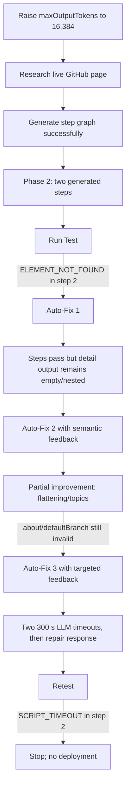

# E1 Service A — Build 4 Report

## Status

**Outcome:** Failed authoring-and-repair build, retained as first-class experimental evidence.

Build 4 began on 2026-08-26 at 17:14:40.416 UTC+08:00. Its final failure screenshot was captured at 18:03:29 UTC+08:00, giving an interactive build window of 2,928.7 seconds (48 minutes 48.7 seconds). The build successfully passed the step-generation boundary that stopped Builds 1–3, reached test execution, and invoked Auto-Fix three times. It never produced an artifact satisfying the frozen semantic criteria. The final repair regressed to `SCRIPT_TIMEOUT` in step 2, and the service was not deployed.

## Intervention under test

Build 4 changed exactly one initial configuration variable relative to Build 3:

```text
maxOutputTokens: 8,192 -> 16,384
```

The 300-second request timeout introduced in Build 3 was retained. Model, endpoint, target, test input, task specification, output schema, and browser remained unchanged.

## Frozen configuration

| Parameter | Value |
|---|---|
| Service identifier | `e1-a-github-repository-search` |
| Target | GitHub public repository search |
| Initial URL | `https://github.com/search?q=web+scraping&type=repositories` |
| Input | `query = "web scraping"` |
| Provider setting | OpenAI |
| Actual API service | Alibaba Cloud Model Studio |
| Model | `deepseek-v4-pro` |
| Endpoint type | China (Beijing) workspace-dedicated |
| Per-request timeout | 300 seconds |
| Maximum output tokens | 16,384 |
| Browser | User's already-running Chrome through Scrapewright |
| Account-changing actions | Prohibited |

The API key and workspace-specific endpoint identifier are intentionally omitted.

## Exact Phase 1 wizard input (verbatim)

### Target URL

```text
https://github.com/search?q=web+scraping&type=repositories
```

### Input parameters

```text
query — required string; GitHub repository search phrase. Test value: web scraping
```

### Page operations and data to collect

```text
Search GitHub public repositories using the query input. Extract exactly the first five repository results. For every result collect repository name, owner, description, repository URL, star count, primary language, and last-updated text. Open each of the first three repository detail pages and additionally collect non-empty About text, topics, and default branch. A detail-page record is not successful if these fields are empty when they are visibly available. Do not modify, star, follow, or otherwise interact with account data.
```

### Output structure

```text
{
  query: string,
  repositories: [{
    name: string,
    owner: string,
    description: string,
    url: string,
    stars: string,
    language: string,
    updatedText: string,
    about: string,
    topics: string[],
    defaultBranch: string
  }]
}
```

+## Input and acceptance criteria

Input parameter:

| Name | Type | Required | Test value |
|---|---|---:|---|
| `query` | string | yes | `web scraping` |

The service had to return exactly five public repository search results with name, owner, description, URL, stars, language, and update text. For the first three repositories, it had to open each detail page and merge non-empty `about`, `topics`, and `defaultBranch` fields directly into the corresponding repository object whenever those values were visible.

Operational step completion alone was explicitly insufficient: empty visible fields, zero-match selector diagnostics, or detail data nested under an extra `result` property failed semantic acceptance.

## Test-design and observed path



## Execution chronology

1. Four research/generation responses returned successfully.
2. Step generation completed with 30,714 input tokens, 8,692 output tokens, and `finish_reason: stop`; the generated artifact contained two steps.
3. Phase 3 schemas and the `web scraping` test input were accepted without manual schema edits.
4. The first test reached Phase 5 but failed with `ELEMENT_NOT_FOUND: h1` in step 2. Console evidence also identified the invalid detail selector `[data-testid="about"]`.
5. Auto-Fix 1 produced a runnable workflow, but the detail values were empty and nested under `result`; this was operationally green but semantically invalid.
6. Auto-Fix 2 flattened the result and populated at least some topic data, but `about` remained empty for a repository with visible About content. The frozen semantic criterion still failed.
7. Auto-Fix 3 targeted `about` and `defaultBranch`. Its first two LLM requests exceeded 300 seconds; a third request returned a repair.
8. The repaired step then failed at runtime with `SCRIPT_TIMEOUT` in step 2.
9. The bounded repair process was stopped. `Deploy Anyway` was not used.

## Token accounting

| Returned response | Input | Output | Total | Reasoning | Cached input |
|---:|---:|---:|---:|---:|---:|
| 1 | 23,539 | 617 | 24,156 | 562 | 0 |
| 2 | 8,103 | 1,695 | 9,798 | 1,200 | 0 |
| 3 | 2,759 | 3,659 | 6,418 | 2,814 | 0 |
| 4 | 30,714 | 8,692 | 39,406 | 7,512 | 14,336 |
| 5 | 18,190 | 455 | 18,645 | 142 | 0 |
| 6 | 19,179 | 1,571 | 20,750 | 1,216 | 0 |
| 7 | 20,651 | 6,587 | 27,238 | 6,135 | 1,024 |
| 8 | 22,263 | 4,589 | 26,852 | 4,190 | 3,072 |
| 9 | 27,168 | 12,583 | 39,751 | 11,709 | 4,096 |
| 10 | 30,776 | 13,112 | 43,888 | 12,028 | 30,720 |
| **Measured sum** | **203,342** | **53,560** | **256,902** | **47,508** | **53,248** |

The log contains 12 requests but only 10 returned usage records. Two Auto-Fix requests timed out after 300 seconds and may have consumed provider-side tokens. Therefore, 256,902 tokens is a measured lower bound, not a complete billing total.

## Failure analysis

### What the intervention solved

The 16,384-token output budget allowed `generateStepsWithSelectors` to finish with usable content. This directly resolves Build 3's empty `finish_reason=length` failure at an 8,192-token cap.

### What remained unsolved

The generated step graph did not reliably ground detail-page selectors against GitHub's current repository DOM. Repairs alternated among:

- missing-element failures;
- operational success with semantically empty output;
- incorrect result nesting;
- partial field recovery; and
- final script timeout.

Thus, output-budget exhaustion was a real blocker but not the only blocker. Raising the budget enabled the pipeline to expose a downstream selector-grounding and repair-stability problem.

### Bounded conclusion

Build 4 demonstrates that the URL and requirements are processable enough to produce and execute a step graph. It does not demonstrate successful compilation, because the artifact failed the preregistered semantic output conditions and remained unstable after three user-invoked Auto-Fix rounds.

## Comparison across Builds 1–4

| Build | Timeout | Output cap | Returned tokens | Terminal outcome |
|---|---:|---:|---:|---|
| 1 | 120 s | 8,192 | 52,078 minimum | 4 step-generation timeouts |
| 2 | 120 s | 8,192 | 41,153 minimum | replicated 4 timeouts |
| 3 | 300 s | 8,192 | 80,271 | reasoning exhausted output cap |
| 4 | 300 s | 16,384 | 256,902 minimum | generated and tested; repair ended in step-2 script timeout |

Across Builds 1–4, returned usage totals at least **345,562 input tokens**, **84,842 output tokens**, and **430,404 total tokens**. This excludes ten timed-out requests across Builds 1, 2, and 4. It must not be represented as the cost of a successfully deployed service.

## Methodological observations

- A larger output budget was necessary but insufficient.
- "All steps passed" did not imply schema-level semantic correctness, demonstrating the need for explicit acceptance checks.
- Three Auto-Fix invocations produced partial progress followed by regression, which is important evidence about repair stability.
- Retry amplification remained significant: two 300-second timed-out repair calls have unresolved provider-side cost.
- The build never reached deployment, so it provides no evidence for zero-token runtime operation.

## Evidence and provenance

- Raw console log: `e1-builds/build-4/console.log`
- Raw-log SHA-256: `44B9B811513509FB7C4A4DA5E48311C7BCD6BB011A6BCACC66281DBF318028F6`
- Aggregate measurements: `e1-tokens.csv`
- Shared environment: `env.txt`
- Final failure screenshot source timestamp: 2026-08-26 18:03:29 UTC+08:00

The console log contains full prompts and live-page excerpts. Review it for incidental account or page information before public release.

## Follow-up options

1. Reconcile the two timed-out Auto-Fix calls in Alibaba Model Studio monitoring.
2. Treat Build 4 as the completed output-budget intervention; do not overwrite it.
3. If continuing, isolate either task complexity, model choice, or wizard grounding behavior in a separately preregistered Build 5 intervention.
4. Save Build 5's console log before producing its report.
